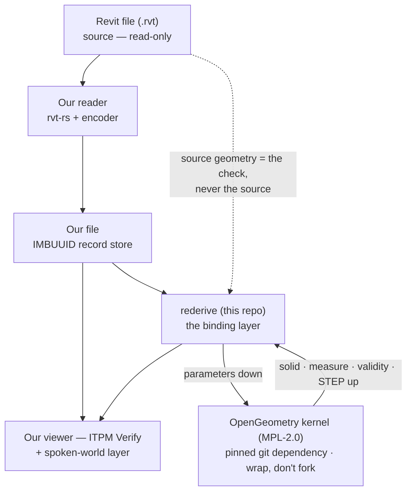

<!--
Ghost Catalog: SOM-DOC-10904-v1.0.0
-->

# rederive

**Geometry as a derivation of the record.**

`rederive` is the binding layer between an identity-bearing record
layer (IMBUUID) and a geometry kernel (OpenGeometry). An addressed
thing — a wall, a slab, a pump, a duct run — resolves through this
crate to its exact solid, its measure, its validity, and its IFC
exchange body, each derivation receipted against the record it came
from.

We were already building our own thing: a standalone Revit reader, an
encoder that binds a building's systems into addressed records, a
verification viewer, a spoken-world layer over the records. What we
were missing was the kernel — exact B-rep geometry with checker-grade
measure. OpenGeometry is that kernel. This repo is the seam between
the two, and the seam is the whole design.

## The architecture

- **Revit enters through our reader.** A `.rvt` file is decoded by
  our own reader (rvt-rs + the encoder) into elements, systems, and
  bound attributes — no Revit process, no bridge.
- **Systems land in our file.** The encoder's output is an IMBUUID
  store: every commissionable or permitable thing an addressed
  record, membership carried in the address itself.
- **Our surfaces read the store.** The verification viewer (ITPM
  Verify) proves nothing was missed and nothing invented; the
  spoken-world layer works over the same records.
- **Geometry is re-derived, never imported.** When a surface needs a
  solid, the record's parameters cross the seam to the kernel, which
  derives the solid, its volume, its validity. The geometry inside
  the Revit file is the *check* the derivation is graded against —
  never the source. (Route B, decided 2026-11-21; importing foreign
  geometry into the kernel was rejected as the path.)
- **Floorkit-class capabilities, emulated on our substrate.** Typed
  element records, layered type catalogs, drawings and quantities as
  derivations of the records — the pattern Ploterr's Floorkit proves
  in the wild, rebuilt here on addressed records. Floorkit itself is
  proprietary; nothing of it is licensed or used.

## The seam is a boundary, not a bridge

- **Data crosses:** parameters down, measures up.
- **Code never crosses:** no IMBUUID or ITPM code enters the kernel
  tree, and no record-layer internals live here. This repo holds the
  *interface* to the identity layer — records named by opaque id —
  not the identity layer.
- **Touchpoints stay narrow:** the derivation call is the seam. One
  named conversion (record parameters → kernel solid) is the whole
  surface.
- **The kernel is a pinned dependency:** commit
  `61c05b12790a534dbb3c7a8a94fd4f9d98ffac07`, unmodified, never
  vendored. See `NOTICE`.

## Where rederive lives

`rederive` stands alone, as its own crate and its own repository. It
is a release vehicle: it is released with IMBUUID addressing built
into its record format, so anyone who adopts the derivation layer
gets IMBUUID wrapped in automatically. Applications depend on it; it
belongs to none of them.

**The ITPM app consumes rederive; rederive does not live inside it.**

First consumers, in order: the ITPM app (per-component solids and
measure under the lifecycle record), rustIVF (kit solids from kit
data), the encoder (derivation cross-checks at ingest verification).

The repo also carries the **connector types** — the mapping layer
between addressed records and the 3D/geospatial tool world (Revit,
Onshape, Blender, kit catalogs), one contract for all: ingest to
records, derive via the kernel, emit from records, receipt every
transform. Connectors are the adoption mechanics: every tool that
pipes through rederive speaks IMBUUID. See
[docs/CONNECTORS.md](docs/CONNECTORS.md).

## Status

Skeleton. The public interface is fixed as typed signatures
(`crates/rederive/src/lib.rs`); bodies land with the first measured
derivation proof. The rulings this repo is built under are captured
in [docs/DECISIONS.md](docs/DECISIONS.md); what is still in flight is
in [docs/OPEN-ITEMS.md](docs/OPEN-ITEMS.md). The harvest that produced
the kernel adoption is SOM-DOC-10902.

## License

MPL-2.0 (see `LICENSE` and `NOTICE`). Geometry is not our invention
lane — the record is. Source we make in this space is shared, in
this space.
