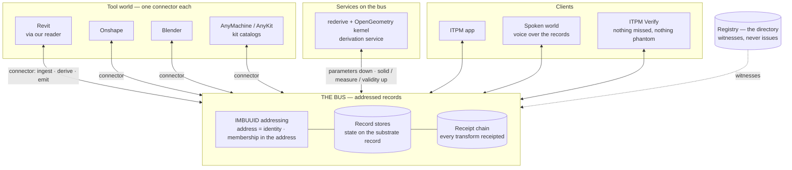

<!--
Ghost Catalog: SOM-DOC-10907-v1.0.0
-->

# BIM BUS — IMBUUID is the bus

The BIM tool world integrates point-to-point. A feasibility tool
pushes its layouts into Revit through its own add-in. A
brief-to-model tool round-trips with Revit through its own link.
Every pair of tools that needs to exchange a building grows its own
adapter, its own identity mapping, its own answer to the question
"which thing is this?" — and every answer dies at the boundary of
the pair that invented it.

**IMBUUID is the bus.** A tool plugs in once, through one
connector, and from then on it exchanges *addressed records* with
every other tool on the bus. The building stops being a file that
tools pass around and becomes a set of records that tools address.
Identity is not mapped at each boundary; it is the medium.

This document is the architecture claim, stated at claim level.
Each bus term below is mapped onto the build that already
implements it, with that build's honest state. Where the vocabulary
does not yet map onto a running build, the gap is named as a bus
requirement still owed — not papered over.

## The vocabulary, mapped

| Bus term | What it is here | Implemented by | State |
|---|---|---|---|
| **Addressing** | A record's address *is* its identity: the IMBUUID, with semantics carried in the identifier itself (SP1) | The record layer + the encoder, which binds a building's elements and systems into addressed records | Proven on the Autodesk samples (systems recovered 238/238 and 240/240, 0 missed / 0 phantom) |
| **Topics / subscription** | System membership is carried in the address structure, so a *topic* is an address segment: subscribing to a system is subscribing to its segment | The encoder's address-carried membership — a system's members enumerate by address, with no lookup | Enumeration proven by measurement (one water system 87/87 by address; a second 26/31 by address, remainder carried as full secondary memberships on the record) |
| **Messages** | Addressed writes — a single write to one record, a range write across a segment. State lives on the substrate record, not in any tool | The record store + the spoken-world layer, which works over records by address | Working over local stores; see *Requirements still owed* for transport |
| **Acks** | Receipts. Every transform and every transition receipts against the record ids it touched; the receipt chain is the bus's delivery proof | The connector contract (docs/CONNECTORS.md) + the estate's hash-chained delivery registry pattern | Contract stated for every connector; the hash-chained receipt pattern is proven in the delivery registry; per-connector emission lands as each connector ships |
| **Adapters** | The connectors — one per tool, one contract for all: **ingest** to records, **derive** via the kernel, **emit** from records | The connector register (docs/CONNECTORS.md): revit, onshape, blender, anymachine/anykit | revit reader **PROVEN**, derivation probe in flight · onshape **BUILT + OFFLINE-VERIFIED**, live use tier-blocked · blender **UNVERIFIED** (host proof owed on OMEN-01) · anymachine/anykit REA complete (SOM-DOC-10905), fit STRONG, connector not yet built |
| **Derivation service** | `rederive` + the OpenGeometry kernel sit *on* the bus: any subscriber hands over a record's parameters and receives its solid, measure, validity, and IFC exchange body — geometry derived from the record, never imported | This repo (the binding layer) + the kernel as a pinned dependency, wrap-don't-fork | Interface fixed as typed signatures; first measured derivation proof in flight |
| **Directory** | The registry: it witnesses which identities exist and what has been receipted against them. It issues nothing | The estate registry + the receipt chain | Witness function proven in the delivery registry; a bus-scoped lookup service is owed (below) |

## The shape

## Not a broker

The bus is an **addressing and protocol discipline**, not hosted
middleware. There is no central server that owns the data, no
broker process that records must pass through, no platform account
a tool must hold. Stores stay where they are — in the tool's own
world, in a project file, on a local disk. What the bus standardises
is how a thing is *named*, how state is *written by address*, and
how every exchange is *receipted*. That is the difference between
the bus and every platform play in the field: a platform wants your
building in its cloud; the bus wants your building addressable,
wherever it lives.

## Plugging in

A new tool joins the bus with exactly one piece of work: **one
connector** implementing the three-part contract
(docs/CONNECTORS.md):

1. **INGEST** — read the tool's source world and land it as
   addressed records. Address assignment is the record layer's act;
   the connector carries the ids it was given and never invents
   identity semantics.
2. **DERIVE** — when geometry is needed, derive it through the
   kernel from the record's parameters. Source geometry is the
   check a derivation is graded against, never the source.
3. **EMIT** — write records back in the tool's format, every
   emitted object traceable to the record id it came from.

And one discipline: **receipt every transform** against the record
ids it touched. A transform with no record ids is an untracked side
effect, and it does not ship.

That is the whole cost of joining. In exchange, the tool's objects
gain what no point-to-point adapter can give them: an identity that
survives every other tool on the bus, membership in systems it did
not model, a lifecycle state no single tool owns, and a receipt
chain that proves what happened to them.

## Bus requirements still owed

Named plainly, so the claim never outruns the build:

- **Live subscription.** Address segments define topics, and
  membership enumerates by address — but no mechanism yet delivers
  writes to subscribers as they happen. Today a client reads the
  store; the bus does not yet push.
- **Cross-machine transport.** Records move between machines as
  store files and snapshots. A wire form for bus traffic — records
  in flight, not files in hand — is not built.
- **Bus directory lookup.** The registry witnesses identity and the
  receipt chain proves delivery, but no service yet resolves an
  address to the store that holds its record. Directory-as-witness
  exists; directory-as-lookup is owed.
- **Derivation proof.** The derivation service's interface is fixed
  and the kernel is adopted and pinned; the first end-to-end
  measured proof (one real element re-derived from its record,
  graded against its source) is in flight, and the service is
  claimed at that grade until it lands.

## Lineage

Founder ruling 2026-11-21: *"we need to make IMBUUID a BIM bus."*
The pieces were built separately — the encoder (addressing,
membership), the connectors (adapters), the receipt chain (acks),
`rederive` (the derivation service). This document names the whole
they already form. The ITPM app dev plan (SOM-DOC-10906) carries the
same framing as its external architecture claim; its connector
generation builds the adapters.
