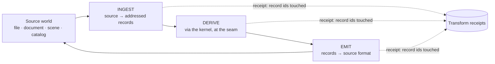

<!--
Ghost Catalog: SOM-DOC-10904-v1.0.0
-->

# CONNECTORS — the adoption mechanics

`rederive` also carries the connector types: the mapping layer
between IMBUUID-addressed records and the 3D / geospatial tool
world. Connectors are how adoption happens — every tool that pipes
through rederive speaks IMBUUID: records in by address, records out
by address, geometry only ever as a derivation of the record.

## The contract (one shape for all)

1. **INGEST** — a source is read and lands as addressed records.
   Address assignment is the record layer's act; a connector carries
   the ids it was given and never invents identity semantics.
2. **DERIVE** — geometry for those records comes only from the
   kernel derivation (`derive` in the crate). Parameters down,
   solid / measure / validity up. Source geometry is the check,
   never the source (Route B, DECISIONS (f)).
3. **EMIT** — records are written back in the source's format, each
   emitted object traceable to the record id it came from.

**Receipts:** every transform — ingest, derivation, emit — is
receipted against the record ids it touched. A transform with no
record ids is an untracked side effect, and it does not ship.

**Boundary:** connector code here is ours and shared (MPL-2.0).
IMBUUID internals stay out — connectors see opaque record ids and
record parameters, nothing more. The contract is a trait in the
crate (`connectors::Connector`); each register entry below has a
stub module carrying the contract as documentation.

## The register (honest states, no upgrades)

| Connector | Direction | State |
|---|---|---|
| **revit** | `.rvt` → records; records → IFC exchange bodies | Reader **PROVEN** by execution; pipe probe **IN FLIGHT** |
| **onshape** | Onshape documents → records | Connector **BUILT + OFFLINE-VERIFIED** (SOM-DOC-10886); live use **BLOCKED** on account tier |
| **blender** | Records → scenes / renders / turntables | Render/emit side; real execution **UNVERIFIED** |
| **anymachine / anykit** | Kit catalogs → type + element records | **CANDIDATE** — REA not yet run |

### revit

The reader half is proven by execution: the standalone reader
(rvt-rs, absorbed pinned in its own line) plus the encoder decoded
the Autodesk samples end to end — 542 elements with 100% of
parameters decoded and bound on the structural sample; on the MEP
samples, 238/238 and 240/240 systems recovered with 0 missed /
0 phantom under two-direction verification. No Revit process, no
bridge. The derivation half — one real element re-derived in-kernel
from its record, graded against the source — is the pipe probe,
in flight as this register is written. The Revit pipe is therefore
claimed as: proven reader, unproven derivation, probe running.

### onshape

The connector is built and offline-verified (SOM-DOC-10886):
read-only slurp of documents, elements, parts, metadata and BOMs,
emitting encoder-shaped rows with source identity carried in the
keymap; offline tests 16/16. Live use is blocked, and the block is
named: both founder accounts are on Onshape's Pro Discovery tier,
which refuses API key creation **and** OAuth app registration — no
credential path exists on that tier. Unblocking is a tier change
(founder decision) or the answer to the open question of how Airsup
authenticates on the same tier. No live claim is made.

### blender

Blender's role is the render/emit side: presentation of derivations
(scenes, renders, dossier turntables), never derivation itself.
The estate's Blender-driving code passes its local suite, but real
Blender execution has never been acceptance-run on the founder's
hardware — graded **UNVERIFIED**, and the register claims no more.

### anymachine / anykit

A candidate, recorded so the owed work is visible. The kit-as-data
judgment stands on other evidence (Floorkit's published pattern;
the estate's IVF kit judgment): author the kit once as data, derive
the rest. For this source line, no REA has been run, no license
verified, nothing absorbed. State: **CANDIDATE**.
