<!--
Ghost Catalog: SOM-DOC-10904-v1.0.0
-->

# DECISIONS — the rederive thread, captured centrally

Every ruling behind this repository, recorded the day it was made
(2026-11-21, America/Los_Angeles). Source record: the founder's
rulings in chat, the day log, and the harvest record SOM-DOC-10902
(`harvest/ploterr/HARVEST.md`). Status grades: **DECIDED** (ruling
made), **PROVEN** (ruling + measured evidence), **PENDING-PROOF**
(ruling made, evidence still in flight).

```mermaid
flowchart LR
    A["(a) the inversion<br/>record is truth"] --> B["(b) Floorkit<br/>emulated, not licensed"]
    B --> C["(c) kernel adopted<br/>MPL · wrap, don't fork"]
    C --> D["(d) open posture<br/>IP is the exception"]
    D --> E["(e) the seam<br/>data crosses, code never"]
    E --> F["(f) Route B<br/>re-derive, don't import"]
    F --> G["(g) the pipe<br/>.rvt → record → derivation"]
    G --> H["(h) rederive stands alone<br/>a release vehicle"]
    H --> I["(i) connectors<br/>the adoption mechanics"]
```

## (a) The inversion: the record is the truth

- **Decision:** Ploterr's zeitgeist claim — the live model is the
  source of truth — is noted and inverted. Our doctrine stands: the
  **record** (identity minted once, never re-keyed) is the truth;
  the model, the drawing, and the solid are readings of it.
- **Date:** 2026-11-21, ~12:49 PT (on the founder-supplied X post by
  @Bootsblac, Ploterr week 3).
- **Reason:** A model can be re-read; an identity cannot be re-minted
  without breaking every receipt that names it.
- **Status:** DECIDED.

## (b) Floorkit: capability emulated, never licensed

- **Decision:** Floorkit's capability — a building authored once as
  typed element records with layered type catalogs, every view a
  derivation — is harvested and emulated on our substrate. Floorkit
  itself is never licensed, embedded, or depended on.
- **Date:** 2026-11-21, ~12:56–13:02 PT (founder: "ploterr is fn
  dope — the floorkit is really cool"; then: the capability "can be
  emulated harvested").
- **Reason:** Floorkit is proprietary (per-hostname key, telemetry
  to license.ploterr.com) — ideas only; the pattern is what transfers,
  and the pattern fits records we already mint.
- **Status:** DECIDED.

## (c) OpenGeometry adopted: MPL as a third license case

- **Decision:** The OpenGeometry kernel is adopted as a pinned Cargo
  git dependency (commit
  `61c05b12790a534dbb3c7a8a94fd4f9d98ffac07`), unmodified, never
  vendored — wrap, don't fork. MPL-2.0 is accepted as a third
  absorption case beside MIT/Apache-2.0.
- **Date:** 2026-11-21, 12:59 PT (founder: "Use it. It's open for
  all the right levels. We aren't trying to invent in this space.
  Share the source we do make.").
- **Reason:** MPL-2.0 is weak, file-level copyleft — a larger work
  may be distributed under different terms, and only modified MPL
  files carry the obligation; geometry is not our invention lane,
  the identity/record layer is.
- **Status:** DECIDED (runtime exercise PENDING-PROOF — see
  OPEN-ITEMS).

## (d) The generalized open posture

- **Decision:** For **all** open things we adopt: use them, and
  share the source we make in that space — **unless** we are
  specifically trying to IP in that space. Default open; IP is the
  named exception, decided per space, not by drift.
- **Date:** 2026-11-21, 13:00 PT.
- **Reason:** Openness is the posture that compounds (the kernel
  exists for us because someone else published); the patent-PREP
  lanes (UUID protocol mechanisms, the identity layer) stay closed
  by explicit exception, not by habit.
- **Status:** DECIDED.

## (e) The seam boundary law

- **Decision:** The binding layer touches the kernel at narrow,
  named points only (the Revit conversion / derivation call). Data
  crosses the seam — parameters down, measures up. Code never does:
  IMBUUID and ITPM code never enter the OpenGeometry tree, and no
  code obligations flow into it; that layer is our IP.
- **Date:** 2026-11-21, 13:06 PT.
- **Reason:** A narrow seam keeps the MPL surface exactly where we
  chose it and keeps the identity layer's obligations at zero.
- **Status:** DECIDED.

## (f) Route B: re-derive, don't import

- **Decision:** Geometry is **re-derived** in the kernel from the
  record's parameters. Source geometry is the check a derivation is
  graded against, never the source. Route A (importing foreign
  geometry into the kernel) is rejected as the path.
- **Date:** 2026-11-21, 13:07 PT (founder: "the re-derive seems to
  be the safest manner").
- **Reason:** Safest on every axis at once — legally (nothing
  foreign enters the kernel tree), technically (no dependence on
  healing someone else's geometry), doctrinally (the record stays
  the source).
- **Status:** DECIDED (end-to-end proof PENDING-PROOF — see
  OPEN-ITEMS).

## (g) The pipe shape

- **Decision:** The pipe is: `.rvt` → our reader (rvt-rs + encoder)
  → our file (the IMBUUID store) → our viewer (ITPM Verify) and the
  spoken-world layer → kernel derivations at the seam, through this
  crate.
- **Date:** 2026-11-21, 13:02–13:06 PT (founder: "can we pipe a
  Revit file now with our reader and use OpenGeometry on top of our
  Revit code?").
- **Reason:** Every stage already exists except the last; the kernel
  is the piece we were missing, not a new product to build around.
- **Status:** PENDING-PROOF (probe running; verdict lands in the
  harvest record, SOM-DOC-10902).

## (h) rederive stands alone — a release vehicle

- **Decision:** `rederive` is its own crate and its own repository.
  The ITPM app is its first consumer, not its owner. It is released
  with IMBUUID addressing built into its record format, so anyone
  who adopts the derivation layer gets IMBUUID wrapped in
  automatically.
- **Date:** 2026-11-21, 13:10 PT.
- **Reason:** A derivation layer owned by one app dies with the app;
  a standalone release vehicle carries the addressing standard into
  every adoption.
- **Status:** DECIDED (this repository is the act).

## (i) Connectors are the adoption mechanics

- **Decision:** `rederive` also carries the connector types — the
  mapping layer between IMBUUID-addressed records and the
  3D/geospatial tool world. One contract for all: INGEST source →
  addressed records · DERIVE via the kernel · EMIT records → source
  format, every transform receipted to the record ids it touched.
  Every tool that pipes through rederive speaks IMBUUID.
- **Date:** 2026-11-21, 13:13 PT.
- **Reason:** A derivation layer nobody can connect to does not get
  adopted; connectors are how the addressing standard travels into
  the tools people already use — the release vehicle (h) needs its
  mechanics.
- **Status:** DECIDED (register and honest states in
  docs/CONNECTORS.md; implementations land per connector, none
  claimed early).
