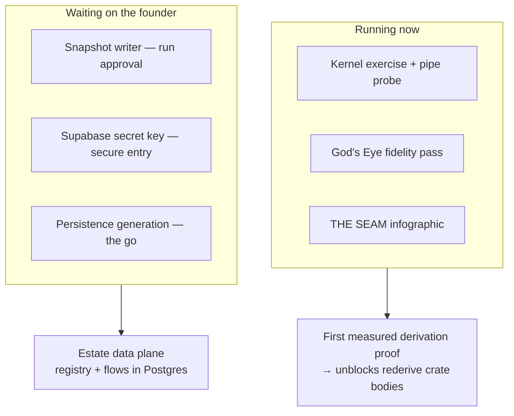

<!--
Ghost Catalog: SOM-DOC-10904-v1.0.0
-->

# OPEN ITEMS — what is still in flight

State as of 2026-11-21, ~13:10 PT. Items close by landing in their
own records, not by being struck here; this page is the index of
what is owed, so a thought in flight is never only in a chat.

## Running now

- **Kernel exercise + pipe probe** — build/test the pinned kernel,
  then the pipe verdict: one real element from the basic Revit
  sample re-derived in-kernel from its record's parameters, kernel
  volume against the source's (Route B, decision (f)/(g)). Results
  land in the harvest record (SOM-DOC-10902). Until they land, the
  kernel's runtime is graded REPORTED; its published surface is
  VERIFIED.
- **God's Eye fidelity pass** — the sprite-stack board's descent and
  fidelity fixes, after the founder's verdict on the first spike
  ("can't zoom into Sonoma; not a fan of the fidelity"). Separate
  surface, same doctrine: forms derived from records.
- **THE SEAM infographic** (SOM-DOC-10903) — the boundary law as a
  figure: SVG + interactive HTML + motion triple-ship.

## Waiting on the founder

- **Snapshot writer run** — the Estate Globe's live-flows writer is
  built and staged (`~/workspace/globe-snapshot-staging/`, SOM-DOC-10900);
  running it is a founder tap. The minute-cadence runner is a
  separate decision after that.
- **Supabase secret key placement** — the board project's secret key
  goes in through the Secure Vault capture (sent 2026-11-21 ~12:47
  PT); API-key lane chosen over OAuth for headless writers
  (rationale in the day log). On placement: the registry and flow
  records get their Postgres home (Supabase = system of record,
  DuckDB = writer workbench, static snapshots stay the serving
  layer — recommendation awaiting the founder's ruling).
- **Persistence generation** — the draft spec answering the
  persistence proof gap (supplier change, re-ingest under a new
  source key, export/handoff — zero re-keyed identities or the
  generation retires) awaits the founder's "go". Spec:
  `spoken-itpm/research/persistence-generation-spec.md`.

## Owed, not yet scheduled

- **First measured derivation proof in this crate** — the `derive`
  body lands when the pipe probe reports; the probe's element
  becomes the crate's first fixture.
- **Registry records for cayman.somacosf.com and sidc.somacosf.com**
  — both sites are live but have no registry records, which blocks
  the Estate Globe's Shells and Space layers (documents staged).
  Rides the estate registry reconciliation.
- **IVF kit-data library** — informed by the Floorkit harvest
  (decision (b): the pattern transfers, the catalog doesn't);
  founder-gated, not started.
- **Snowdon Towers discipline files** (Electrical / HVAC / Plumbing)
  — the stronger MEP probe corpus; download into the witness Drive
  folder is the founder's act, not yet received.
